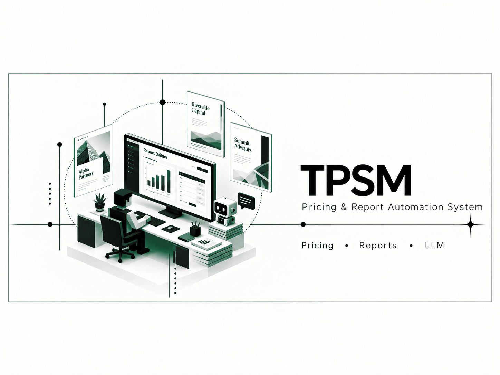

### A transfer-pricing workspace for structured studies, source ingestion, assisted analysis, and document generation.

## Overview

TPSM supports the preparation of transfer-pricing work by organizing source material, analysis, report content, and generated deliverables in a single workspace.

## My Contributions

- Developed report-building and document automation workflows
- Integrated structured ingestion and local retrieval-assisted analysis
- Connected editable report sections with Word and PDF generation
- Designed the workflow around professional review rather than unattended generation

## Project Highlights

- Structured report workspace
- Document ingestion and retrieval
- AI-assisted drafting
- Word and PDF deliverables

## System Architecture

A Django application coordinates project data, source documents, retrieval, editable report sections, and document renderers. Local AI components assist analysis while users retain control over final content.

## Tech Stack

`Python` `Django` `LangChain` `ChromaDB` `Local LLMs` `Document processing` `Word/PDF generation`

## Results

- Reduced repetitive report assembly
- Kept source material connected to the working study
- Created a reviewable path from ingestion to final document

## Screenshots

Additional sanitized product screenshots will be added when they can be shared without exposing private data or infrastructure.

## What I Learned

Professional document automation must preserve editability and provenance. Useful AI assistance fits into a review workflow instead of replacing subject-matter judgment.

## Privacy and Ownership

> This is a documentation-only case study. The production repository, customer material, prompts, templates, and infrastructure are private.

## Contact

- [LinkedIn](https://www.linkedin.com/in/dev-ai-erick)
- [GitHub](https://github.com/DevDope)

---

This repository is maintained as a professional portfolio case study. No license to proprietary source code or private assets is granted.
